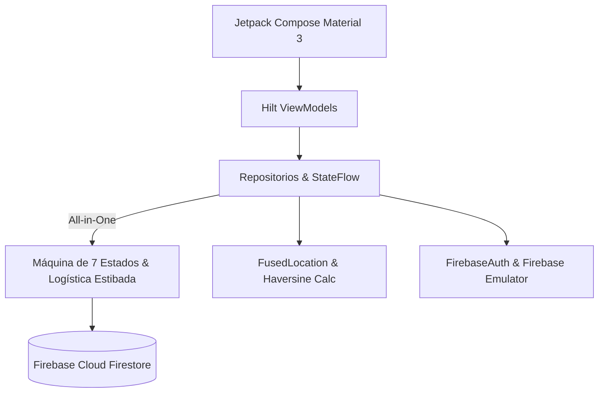

# Cooperativa SMA — Infraestructura Digital Open Source para una Economía Local Justa

[](https://www.gnu.org/licenses/agpl-3.0)

| Cliente | Micronegocio | Repartidor | Checkout |
| :---: | :---: | :---: | :---: |
|  |  |  |  |

El modelo de extracción de capital (comisiones del 30% al negocio y tarifas precarizantes al repartidor) es insostenible para el comercio hiperlocal. **Cooperativa SMA** nace en San Miguel de Allende, México, como una alternativa libre, transparente y cooperativa. 

Este repositorio no es solo una app de *Delivery*; es la **Vertical 1** de un ecosistema modular diseñado para escalar, empoderar oficios, servicios y alentar el consumo local en un modelo económico circular.

## El Modelo de 4 Actores (La Tabla de Valor Circular)

| Actor | ¿Qué Aporta al Ecosistema? | ¿Qué Gana? (Beneficio Cooperativo) |
| :--- | :--- | :--- |
| **🏠 Clientes (Vecinos)** | Demanda hiperlocal y masa crítica. Precios justos sin márgenes inflados. | Apoyo directo a su economía de barrio. Entregas seguras mediante PIN de 4 dígitos. |
| **🏪 Micronegocios** | Oferta de productos, variedad y riqueza local. | **0% Comisión sobre ventas.** Acceso a herramientas de gestión (KDS), control de inventario y visibilidad local. |
| **🛵 Repartidores** | Infraestructura de transporte y logística ágil. | Tarifa de entrega justa calculada por GPS (100% de la cuota va a su bolsillo). Flexibilidad, dignidad y seguridad (Fórmula Haversine). |
| **💻 Colaboradores (Tech)** | Código abierto, mantenimiento, seguridad y escalabilidad (Tú). | Participación en la construcción de una plataforma de impacto real y, en Fase 2, acceso al Fondo de Retribución Gradual (Bounties). |

---

## 🗺️ Sostenibilidad y Hoja de Ruta de Retribución (Transparencia Total)

Para asegurar la supervivencia a largo plazo del proyecto y su adopción, la retribución económica a colaboradores técnicos se habilita de **forma progresiva**, con base en hitos y utilidades reales. No prometemos fondos que aún no existen en el lanzamiento.

### Etapa 1 — Lanzamiento y Validación en Calle *(Fase Actual)*
El objetivo es salir en línea en San Miguel de Allende, logrando utilidad real (operación diaria de órdenes, negocios despachando y repartidores cobrando de forma eficiente).
Las contribuciones de los desarrolladores tecnológicos en esta fase son voluntarias y sientan las bases del sistema y el equipo Core. Toda aportación quedará registrada con atribución pública inmutable.

### Etapa 2 — Activación del Fondo Tecnológico (Punto de Equilibrio Cloud)
Una vez que el proyecto alcance masa crítica y la **Cuota Operativa Cooperativa** (un recargo mínimo y transparente en cada envío) comience a recaudarse, la plataforma pagará primero los costos de infraestructura mensual en Firebase/GCP. Cuando se superen esos gastos, el excedente servirá para abrir el fondo de recompensas (**Bounties**) para remunerar económicamente los *Issues* resueltos.

### Etapa 3 — Consolidación Cooperativa
Conforme crezcan los usuarios e iniciemos la Vertical 2 (Servicios, Plomeros, Carpinteros), las recompensas y fondos aumentarán proporcionalmente para los mantenedores y colaboradores de la comunidad más comprometidos, usando sistemas abiertos (como *Open Collective* o GitHub Sponsors).

---

## 🏗️ Arquitectura del Ecosistema

La app está construida 100% en nativo con **Kotlin 2.0+** empleando Clean Architecture y MVVM.



> **Sistema de Diseño SMA:** Colores Cantera/Terracota (#C85A32) y Verde Agave (#2E7D32)

---

## 🚀 Guía de Arranque Rápido (Local Emulator)

Ahorra tiempo y prueba los tres roles (Cliente, Negocio, Repartidor) simulando el backend local con los datos sembrados automáticamente.

**Paso 1. Instalar y Levantar Firebase Emulator**
*(Desde la terminal, requiere Node.js y Firebase CLI)*
```bash
firebase init emulators
firebase emulators:start
```
*Se levantarán Auth (9099) y Firestore (8080).*

**Paso 2. Enlazar Puertos hacia el Emulador Android**
*(Ejecuta esto con el emulador Android Studio abierto y detectado por adb)*
```bash
adb reverse tcp:9099 tcp:9099 && adb reverse tcp:8080 tcp:8080
```

**Paso 3. Compilar e Instalar App (DEBUG)**
```bash
./gradlew installDebug
```
La aplicación correrá, y si la base de datos está vacía, el **LocalFirebaseSeeder** sembrará los 3 perfiles con menú y ubicación en San Miguel de Allende. ¡Abre la app y entra directo usando las tarjetas de Acceso Rápido!
